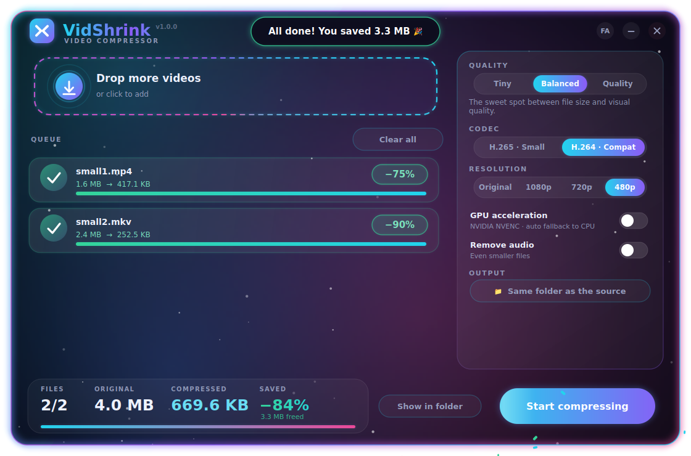

<div align="center">


# VidShrink

**A glowing, animated Windows video compressor.** Drag. Drop. Shrink.

[](https://github.com/YOUR_USER/VidShrink/actions)




</div>

## ✨ Features

- **Drag & drop** files or whole folders, batch queue with live progress, speed and ETA
- **3 quality presets** – *Tiny*, *Balanced*, *Quality* – tuned CRF values, no knobs to get wrong
- **H.265 (HEVC)** for the smallest files or **H.264** for maximum compatibility
- **Downscale** to 1080p / 720p / 480p (never upscales)
- **NVIDIA GPU acceleration** (NVENC) with automatic CPU fallback
- Smart: if a file can't get meaningfully smaller, your **original is kept** and no junk is written
- Runs `ffmpeg` at *below-normal* priority so your PC stays responsive while encoding
- Fully custom animated UI: aurora background, neon glow, shimmering progress, confetti 🎉
- **English / فارسی** UI (toggle in the title bar), remembers all your settings
- Portable – one `.exe`, ffmpeg is bundled, nothing to install

<details>
<summary>More screenshots</summary>

| Empty | Persian |
|---|---|
|  |  |

</details>

## 📥 Download

Grab `VidShrink.exe` from the [**Releases**](../../releases) page (or from the *Actions → Artifacts* of any green build).

## 🛠 Run from source

```bash
git clone https://github.com/YOUR_USER/VidShrink.git
cd VidShrink
pip install -r requirements.txt
python run.py
```

## 📦 Build the .exe yourself

On Windows just double-click **`build.bat`**, or:

```bash
pip install -r requirements-dev.txt
python scripts/build.py            # single file  -> dist/VidShrink.exe
python scripts/build.py --onedir   # folder build -> dist/VidShrink/  (starts faster)
```

### Releasing via GitHub Actions

```bash
git tag v1.0.0
git push origin v1.0.0
```

The workflow runs the tests, builds the exe on `windows-latest` and attaches it to a GitHub Release automatically.

> 💡 **Exe size:** ~100 MB, because a full static `ffmpeg` is inside. If you want it smaller, build your own
> slimmed-down `ffmpeg.exe`, put it next to `VidShrink.exe` – it takes priority over the bundled one.

## 🧠 How it works

| Preset | H.265 CRF | H.264 CRF | Audio | Typical saving |
|---|---|---|---|---|
| Tiny | 30 | 26 | 64 kbps stereo | 80–95 % |
| Balanced | 27 | 23 | 96 kbps | 60–85 % |
| Quality | 23 | 19 | 128 kbps | 40–70 % |

Output is always `name_vidshrink.mp4` (`+faststart`, `hvc1` tag for Apple devices) next to the source, or in the folder you pick.

## 🗂 Project layout

```
run.py                  entry point (also used by PyInstaller)
src/vidshrink/
  app.py                main window, aurora background, app logic
  widgets.py            custom animated widgets (glow buttons, drop zone, queue cards…)
  theme.py              palette, glow helpers, shared 60 fps clock
  engine.py             ffmpeg discovery, probing, command builder, worker thread
  i18n.py               English + Persian strings
scripts/build.py        PyInstaller build        scripts/make_assets.py   icon generator
tests/                  pytest unit tests        .github/workflows/       CI + release
```

Want to tweak things? The preset table lives in `engine.py` (`PRESETS`), colours in `theme.py`,
and adding a language is just another dict in `i18n.py`.

## 🇮🇷 فارسی

**VidShrink** یک برنامه‌ی ویندوزی برای کم‌حجم کردن ویدیوهاست، با رابط کاربری انیمیشنی و نورانی.
ویدیوها (یا یک پوشه) را بکشید و رها کنید، یکی از سه کیفیت را انتخاب کنید و «شروع فشرده‌سازی» را بزنید.
نسخه‌ی آماده را از بخش **Releases** بگیرید؛ نیازی به نصب FFmpeg نیست و همه‌چیز داخل برنامه است.
زبان برنامه با دکمه‌ی **FA / EN** بالای پنجره عوض می‌شود.

## 📄 License

MIT – see [LICENSE](LICENSE). FFmpeg is licensed separately (LGPL/GPL depending on build).
